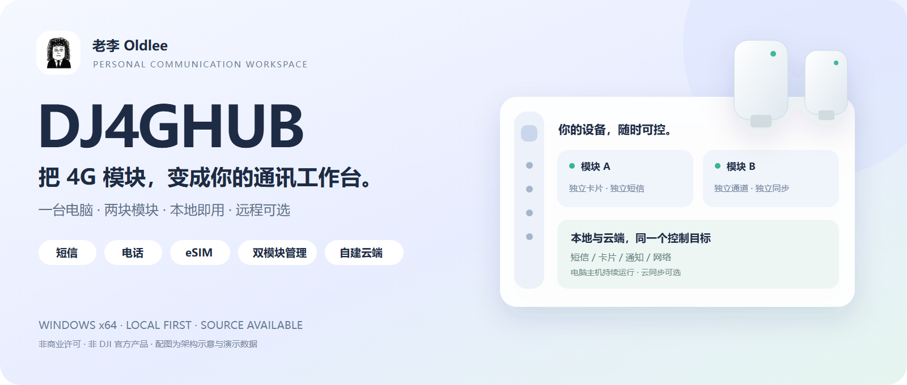
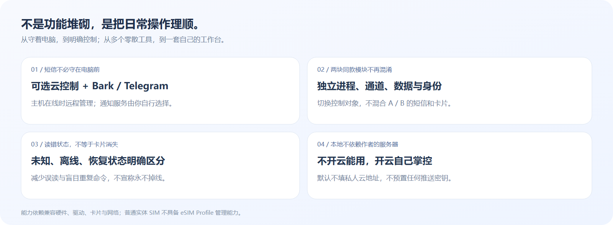
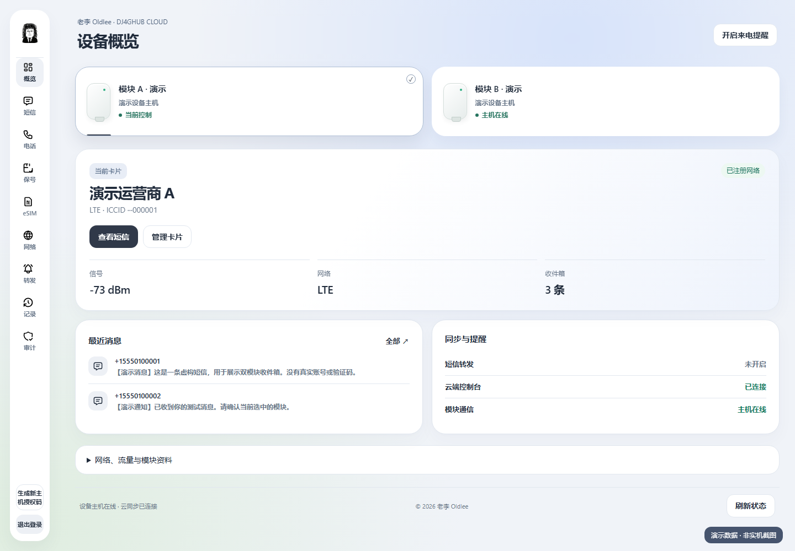
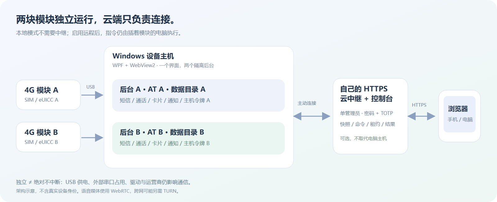

<div align="center">



# DJ4GHUB · 老李 Oldlee

**一台电脑，两块模块。本地即用，远程可选。**

短信 · 电话 · eSIM · 双模块 · Bark / Telegram · 自建云控制台

Windows 10 / 11 x64 ｜ Go + WPF + WebView2 ｜ 0.6.7 公开预览版

[](https://github.com/Oldleeo/DJ4GHUB/actions/workflows/ci.yml)

[GitHub 仓库](https://github.com/Oldleeo/DJ4GHUB) · [问题反馈](https://github.com/Oldleeo/DJ4GHUB/issues)

[**下载安装包 · Windows x64**](https://github.com/Oldleeo/DJ4GHUB/releases/download/v0.6.7/DJ4GHUB-Windows-x64-0.6.7-Setup.exe) · [所有下载 / 校验和](https://github.com/Oldleeo/DJ4GHUB/releases/tag/v0.6.7)

[快速开始](docs/QUICK_START.md) · [双模块管理](docs/DUAL_MODULES.md) · [自建云端](docs/SELF_HOSTING.md) · [技术细节](docs/TECHNICAL_DETAILS.md) · [老李的 X](https://x.com/oldleeoo)

</div>

> 面向个人使用，继承上游 **PolyForm Noncommercial 1.0.0** 许可，并非允许任意商用的 MIT / Apache 项目。**本地使用只需安装，不需要部署服务器。** 不提供公共云服务、不附带个人凭据。所有公开截图使用演示数据。

## 为什么做这个

模块明明插在电脑上，收短信却还要守着电脑；切换卡片时信息不更新；再接一块相同模块，又分不清正在控制谁。DJ4GHUB 把这些操作放到一个工作台里：看状态、收发短信、管理卡片，并在需要时从自己的云端接入。



它不是“把模块变成手机”的万能工具，也不替运营商解除任何限制。它解决的是：**已有兼容模块如何更方便、更明确、更可控地使用。**

## 界面预览

空间层叠布局、统一深浅色、可调字号与密度，窗口装饰和内容使用同一套主题。配图来自实际页面的演示环境，不包含真实短信、号码、卡片身份或服务器资料。

| 双模块概览 | 短信工作台 |
| --- | --- |
|  |  |
| 深色设置 | 云端控制台 |
|  |  |

## 能做什么

| 功能 | 本地 Windows | 可选云控制台 | 使用边界 |
| --- | --- | --- | --- |
| 模块、SIM、信号、网络状态 | ✓ | ✓ | 状态来自设备；断电或离线不能通信 |
| 双模块识别、切换与独立数据 | ✓ | ✓ | 两块实机已做过验证；不是保证任意数量 |
| 短信收件箱、发送、单条删除 | ✓ | ✓ | 操作可能产生运营商费用；删除不可撤销 |
| 拨号、接听、挂断、DTMF | ✓ | ✓ | SIM、运营商、固件必须支持语音 |
| 通话音频桥接 | USB 音频 | WebRTC | 需兼容音频设备；跨网可能需要 TURN |
| eSIM 二维码解析、Profile 下载/启停/改名/删除 | ✓ | ✓ | 必须插入兼容 eUICC；普通实体 SIM 不支持 |
| Bark / Telegram 新短信通知 | ✓ | ✓ 配置 | 自备密钥；短信内容会发给对应推送服务 |
| 保号提醒与记录 | ✓ | ✓ | 辅助提醒，不自动充值，不保证满足各运营商条款 |
| APN / 网络配置、联网状态 | ✓ | ✓ 主要管理操作 | Windows 路由和适配器仍由本机执行 |
| 高级 AT 调试 | 默认隐藏 | 未提供默认界面入口 | 只给明确知道指令影响的人使用 |
| UI、主机诊断、开机自启、托盘 | ✓ | 部分显示/操作不同 | 原生窗口、托盘、自启不是浏览器功能 |

**云端覆盖主要模块管理流程，不等于浏览器具有 Windows 原生功能。** 具体对照见[功能与限制](docs/FAQ.md)。云端不是脱离设备的模拟器：操作最终仍由插着模块的电脑执行。

## 三步开始本地使用

1. [下载 Windows 安装包](https://github.com/Oldleeo/DJ4GHUB/releases/download/v0.6.7/DJ4GHUB-Windows-x64-0.6.7-Setup.exe)，双击安装。后台、.NET 运行时和桌面图标自动配置；缺少 WebView2 时会联网安装 Microsoft 官方运行环境。
2. 双击桌面的 **DJ4GHUB**，插入兼容 DJI 4G 模块。USB/AT 驱动需正确安装，不会自动安装未签名驱动。
3. 插入一块或两块模块，选择模块卡片，即可查看状态和收件箱。先用低风险读取操作确认识别，再自行测试短信与电话。

**不启用云同步也能正常使用本地功能。** 默认云地址为空、主机同步关闭；本地后台只监听 `127.0.0.1`。

无需安装 Git、Go 或 .NET SDK。升级前从托盘退出旧版；卸载保留配置与短信。安装包暂未代码签名，Windows 可能提示“未知发布者”，请只从本仓库 Release 下载并核对 SHA-256。默认安装到当前用户的 `%LOCALAPPDATA%\Programs\DJ4GHUB`，不修改其他目录中的旧版本。

喜欢免安装的用户可下载同一 Release 的 `Portable.zip`，完整解压后启动 `DJ4Hub.Windows.exe`，不能只复制一个 EXE。便携版需电脑已有 WebView2。

<details>
<summary>从源码构建 Windows 包</summary>

需要 Git、Go（版本见 `go.mod`）和 .NET 8 SDK。以下命令在 Windows PowerShell 中执行：

```powershell
# 下载/克隆本仓库后，先进入仓库根目录
./scripts/audit-public.ps1
./scripts/build-windows.ps1
# 完成后启动 dist/windows/portable/DJ4Hub.Windows.exe
```

源码公开包本身不是可直接双击的安装包。构建不会安装驱动，也不会把用户私人数据打进程序。

</details>

更多首次使用、通知配置与 eSIM 步骤，见[完整使用指南](docs/QUICK_START.md)。

## 两块模块，为什么不只是“两个按钮”



每块模块都有独立后台进程、AT 通道、数据目录和云端主机身份。切换页面只是切换当前控制对象，不会把 A 的短信当成 B 的短信。一个主机恢复时，另一个主机可以继续工作。

初次发现第二块模块时，会在本机复制已有的通知设置作为默认值；**之后两块模块的通知配置独立，云同步也必须分别启用。** 公开包不会预绑定任何人的 Bark 或 Telegram。

[查看双模块完整说明 →](docs/DUAL_MODULES.md)

## 想在手机上远程用？自建云端是可选项

设备主机主动连自己的 HTTPS 中继，浏览器访问 `/panel/`。不需要把本机 AT 服务暴露到公网，也不需要给电脑做端口转发。

仓库提供 Docker Compose + Caddy 部署模板，准备好 Linux 服务器、域名和 Docker 后：

```bash
cd deploy/selfhost
cp .env.example .env
# 编辑 .env：填写自己的域名和 ACME 邮箱
docker compose up -d --build
```

控制台使用密码和 TOTP；Windows 主机首次注册使用服务器生成的 `owner.token`。两者不是同一个密码。部署、凭据读取、双模块绑定、备份与更新见[自建云端指南](docs/SELF_HOSTING.md)。

> 中继是单管理员/个人实例，不是多用户 SaaS。Docker 模板本机未做真实公网部署验证；CI 提供构建检查，正式使用前仍需在自己的服务器验证 HTTPS、登录、注册和完整操作链路。语音跨网络场景另需检查 TURN。

## 稳定性与安全，具体做了什么

- 串口所有权互斥、限定设备发现范围，避免本软件的扫描和主机互相争抢。
- 每模块独立健康检查、故障恢复与退避；父进程退出后清理所属后台。
- 云端变更命令落盘去重；异常时不盲目重发短信或拨号，结果不明需人工核对。
- SIM 信息读取失败视为“未知”，不把临时错误直接当成“没插卡”。
- HTTPS、密码 + TOTP、会话和命令权限检查；云端持久化状态使用 AES-GCM。
- 发布前使用独立脱敏目录，排除私人配置、运行数据、旧日志、备份和原仓库 Git 历史。

这些是设计措施和已实现的保护，不是“永不掉线”的保证。USB 供电、第三方串口工具、驱动和运营商仍会影响实际使用。[隐私说明](docs/PRIVACY.md) · [安全说明](SECURITY.md)

## 文档入口

| 想了解什么 | 阅读这里 |
| --- | --- |
| 安装、首次使用、短信、eSIM、通知 | [快速开始](docs/QUICK_START.md) |
| 模块识别、切换、绑定、故障隔离 | [双模块管理](docs/DUAL_MODULES.md) |
| 云端部署、凭据、TLS、备份、TURN | [自建云端](docs/SELF_HOSTING.md) |
| 进程、串口、API、数据一致性、安全 | [技术细节](docs/TECHNICAL_DETAILS.md) |
| 不识别、普通 SIM 报错、离线、音频 | [常见问题](docs/FAQ.md) |
| 数据去哪、哪些不上传、通知风险 | [隐私说明](docs/PRIVACY.md) |
| 许可来源、商业使用限制 | [源码与许可](docs/SOURCE_AND_LICENSE.md) |
| 首次上传 GitHub 的检查步骤 | [发布清单](docs/PUBLISHING.md) |
| 参与开发、回归与配图更新 | [贡献指南](CONTRIBUTING.md) |

源码现发布于 [Oldleeo/DJ4GHUB](https://github.com/Oldleeo/DJ4GHUB)。构建状态以 [GitHub Actions](https://github.com/Oldleeo/DJ4GHUB/actions) 为准；尚未提供正式二进制 Release。

## 版权与致谢

© 2026 **老李 Oldlee**，本版本的品牌、界面与新增贡献。作者 X：[**@oldleeoo**](https://x.com/oldleeoo)。

本项目含上游 VoHive 衍生代码，保留必需声明：**Copyright iniwex5**（[VoHive](https://github.com/iniwex5/vohive)）；另参考 DJOneHub 的相关工作。完整条款见 [LICENSE](LICENSE) 与 [THIRD_PARTY_NOTICES.md](THIRD_PARTY_NOTICES.md)。第三方图标与库保留各自许可。

DJI / 大疆及相关名称、商标属于其权利人。DJ4GHUB 不是 DJI 官方软件，不隶属于 DJI，也未声明获得其认证。老李 IP 头像及品牌素材不自动授予独立商业使用或冒充作者的权利；权利说明见[许可文档](docs/SOURCE_AND_LICENSE.md)。
