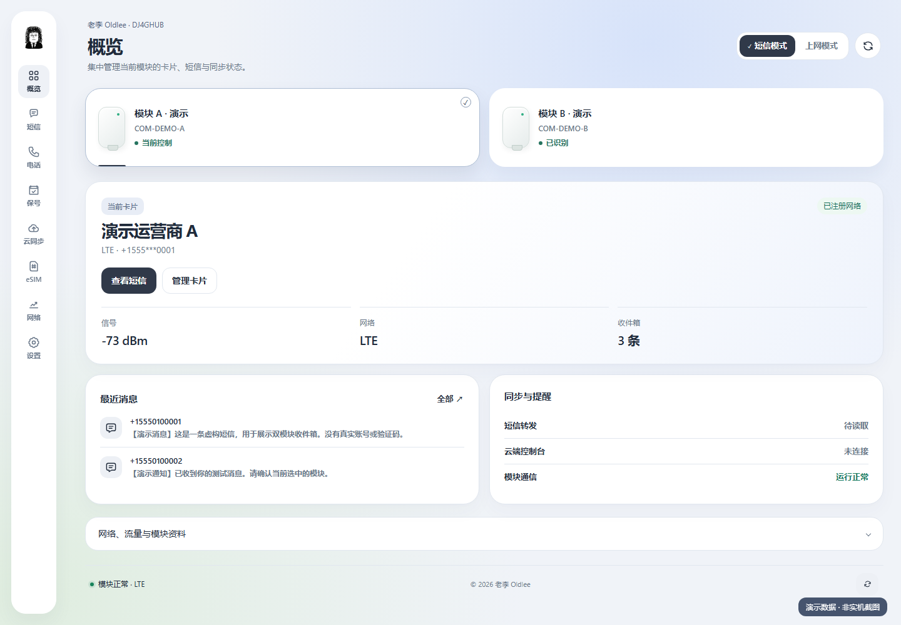
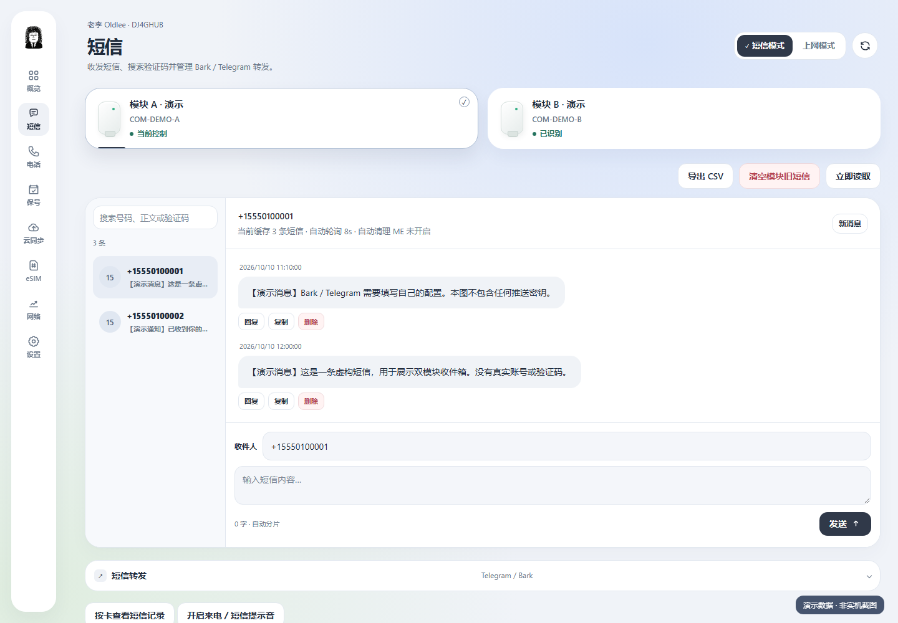
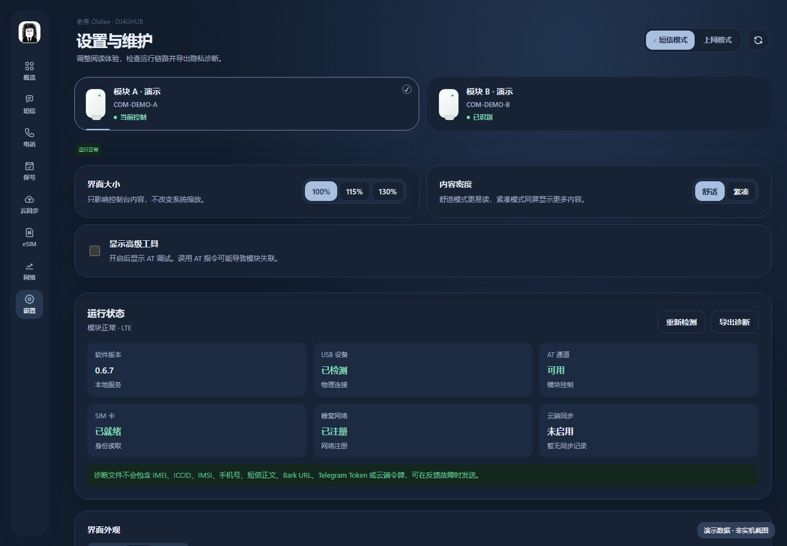

# 快速开始：先让本地跑起来

## 1. 准备

当前目标是 Windows 10/11 x64。准备兼容模块、支持数据传输的 USB 线、稳定供电和正确的已签名 USB/AT 驱动。设备管理器中应出现 **Quectel USB AT Port**；当前自动发现限定 `VID_2CA3&PID_4006`。不支持的 USB 变体不能只凭“大疆 4G 模块”名称保证兼容。

WebView2 Runtime 用于界面；.NET 8 SDK 与 Go 只在从源码构建时需要。未来便携包包含 .NET 运行时，不包含硬件驱动。

首次用电脑直连 USB 口排查，不要先叠加无供电扩展坞。没有驱动时请向硬件/驱动供应方获取可信、已签名版本；本项目不静默安装驱动，也不建议关闭系统安全验证。

## 2. 启动

源码版：在仓库根目录运行 `./scripts/build-windows.ps1`，输出在 `dist/windows/portable/`。Release 发布前没有正式下载链接，请不要从未知站点下载同名 EXE。

完整解压便携包，双击 `DJ4Hub.Windows.exe`。`backend/`、运行时文件、许可证都要保留。后台会自动启动，不用另开 Go 程序。本机配置放在 `%LOCALAPPDATA%\DJ4Hub\`，不是压缩包内。

进入概览后确认 USB 检测、AT 可用、SIM 就绪、网络注册。刷新只重新读取状态，不应最小化窗口；模块恢复中可能短暂显示“未知”。

## 3. 短信

选择正确模块 → 短信 → 打开收件箱。选择单条短信查看全文、复制内容或删除。删除前确认：这不是可回收的文件操作。发送时填写自己有权联系的号码与内容，确认可能的运营商费用。

切换模块后，收件箱应对应当前模块；不要凭号码尾号猜测选中的卡。首次实测可用自己的另一部手机发一条普通测试短信，确认只在目标模块出现。

## 4. 电话

号码键盘在未通话时用于输入号码；主动点击拨打才发起电话。接通后按键可作为 DTMF。语音必须由卡、套餐、运营商和模块固件共同支持。

电脑音频需枚举到模块 USB 音频设备；浏览器远程音频需要麦克风授权、HTTPS 和网络连通。拨号成功不等于音频双向成功，分别测试接听、说话、听音与挂断。

## 5. eSIM / 卡片

普通实体 SIM 只可读基础卡片/网络信息，不支持 Profile 管理。若出现“未发现 eUICC / 打开 logical channel 失败”，先确认卡片类型，不要反复下载激活码。

兼容 eUICC 卡：打开 eSIM / 卡片，刷新卡片信息；上传二维码图片、相机扫描或填写 `LPA:1$SM-DP+地址$激活码`。检查解析信息后主动提交下载。激活码可能一次性有效，也可能受运营商限制。

启用 Profile 前先确认当前模块、ICCID/昵称；网络重新注册需要等待。启用后概览与 Profile 状态应最终一致；若未恢复，检查 AT 状态并再次读取，结果未确认前不要连续重复切换。

不能直接把手机中已启用、不可导出的 eSIM 复制到模块，通常需要运营商提供新的激活方式。不保证所有消费级 eSIM 与可编程 eUICC 兼容。

## 6. 配置 Bark / Telegram

在通知/设置区域填写自己的 Bark 服务 URL，或 Telegram Bot Token + Chat ID，启用对应转发。云端也可以配置这些选项，实际推送由设备主机执行。公开版不会提供或预绑定作者的密钥。

测试通知仅用于确认推送通路，不等于已验证真实新短信转发；再用自己的手机发一条短信检查一次。短信可能含验证码，开启转发就意味着这些内容会到达相应第三方服务。

第二块模块首次接入可能继承第一块的通知配置，之后请分别检查、测试和修改。不要认为“模块在线”就代表 Bark 配置成功。

## 7. 保号、网络与设置

保号助手用于保存到期时间、提醒与维护记录；不自动充值，不承诺运营商一定延长有效期。到期规则以自己卡片的官方条款为准。

网络页用于读取与配置 APN 等信息。切换短信/上网模式可能导致设备重新枚举、网络短暂掉线；不要在正在通话或下载 Profile 时反复切换。

设置中可调界面比例、密度、浅色/深色/自动主题。高级 AT 默认隐藏。误用 AT 可修改模块工作模式，不熟悉时保持关闭。

## 8. 退出与可选云同步

窗口关闭后默认进入托盘，不代表设备主机已经停止。完全退出请用托盘“退出”。开机自启是可选项，不自动替你开启。

只做本地使用：保持云同步关闭。远程使用：阅读[自建指南](SELF_HOSTING.md)，每块模块分别填写服务器地址并注册。电脑和软件必须持续运行；电脑睡眠、断电、断网时不能执行远程命令。
